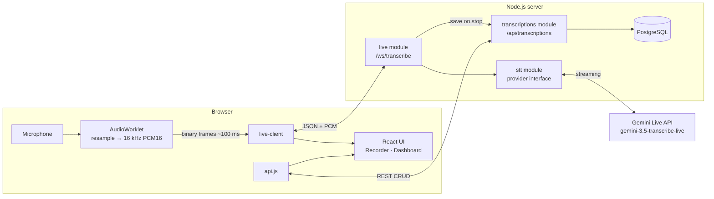

# Bolo — Real-time Speech to Text (Hindi + English)

A web app where you speak — in Hindi, English, or a natural mix of both (Hinglish) — and see the words appear **as you talk**. Every recording is saved to PostgreSQL and managed from a **history dashboard with full CRUD**, plus **read-aloud (Text-to-Speech)**.

> **Live demo:** _link added after deployment_
> **Assignment:** Procucev AI — Tech Hiring, Assignment 1 (Real-time Transcription)

---

## Features

| | |
|---|---|
| 🎙 **Real-time transcription** | Streaming audio over WebSocket → Gemini Live. Grey *interim* text updates while you speak, then becomes black *final* text. |
| 🌐 **Multilingual / code-switching** | Auto language detection handles Hindi–English mixing mid-sentence. Optional hints: Hindi + English, Hindi, English (India). |
| 💾 **Persistence** | Transcript saved automatically when you stop (or if the connection drops), with duration and language. |
| 📋 **Dashboard CRUD** | List (newest first), search, pagination, create manually, edit title/text, delete (two-step confirm). |
| 🔊 **Text-to-Speech** | "Listen" plays any transcript using the browser's on-device Web Speech API (free, no key), preferring Hindi / Indian-English voices. |

## Tech stack

- **Backend:** Node.js (ES modules, plain JavaScript), Express 5, `ws`, `pg`, `zod`
- **Speech-to-text:** Gemini Live API, model `gemini-3.5-transcribe-live` (`@google/genai`)
- **Database:** PostgreSQL (raw parameterised SQL + a small migration runner)
- **Frontend:** React 19 + Vite, AudioWorklet for audio capture
- **Tests:** Vitest + Supertest (against a real Postgres)
- **Deploy:** Render (web service) + Neon (managed Postgres); Dockerfile / docker-compose for any VPS

---

## Architecture



**Why the server sits between the browser and Gemini:** the API key never reaches the browser, and the server is the single place that turns a live stream into a saved database row (even if the browser tab closes mid-recording).

### Real-time flow

1. **Capture** — `getUserMedia` → an **AudioWorklet** running on the audio thread resamples the mic's native rate (usually 48 kHz) to **16 kHz mono 16-bit PCM** with linear interpolation and emits ~100 ms chunks (plus an RMS level for the mic ring).
2. **Stream** — chunks go over one WebSocket as binary frames. Audio that arrives while the Gemini session is still connecting is buffered (≤ 5 s) so the first words are not lost.
3. **Transcribe** — the server forwards PCM to Gemini Live with `inputAudioTranscription` and automatic language detection. Gemini returns:
   - `interimInputTranscription` → relayed as `{type:"interim"}` (speculative, replaced)
   - `inputTranscription` → relayed as `{type:"final"}` (appended)
4. **Stop & save** — the server sends `audioStreamEnd`, waits briefly for the last final segment, joins the segments, and inserts the row. The client receives `{type:"saved", transcription}` and the dashboard refreshes.

### WebSocket protocol — `/ws/transcribe`

| Direction | Message |
|---|---|
| client → server | `{"type":"start","languageCodes":["hi-IN","en-IN"]}` (codes optional, empty = auto) |
| client → server | binary: 16 kHz / 16-bit LE / mono PCM |
| client → server | `{"type":"stop"}` |
| server → client | `ready` · `interim {text}` · `final {text}` · `saved {transcription}` · `empty` · `error {message}` |

### REST API

| Method | Path | Description |
|---|---|---|
| `GET` | `/api/transcriptions?q=&page=1&limit=10` | List, newest first, search title + text |
| `GET` | `/api/transcriptions/:id` | Read one |
| `POST` | `/api/transcriptions` | Create `{content, title?, language?}` — title derived from text if omitted |
| `PUT` | `/api/transcriptions/:id` | Update `{title?, content?, language?}` |
| `DELETE` | `/api/transcriptions/:id` | Delete → `204` |
| `GET` | `/api/health` | DB connectivity check |

Validation errors return `400 {error, details: {field: message}}`; unknown ids return `404`.

### Database

```sql
CREATE TABLE transcriptions (
  id           SERIAL PRIMARY KEY,
  title        VARCHAR(200) NOT NULL,
  content      TEXT         NOT NULL,
  language     VARCHAR(32),                -- 'auto' or BCP-47 hints, e.g. 'hi-IN,en-IN'
  source       VARCHAR(16)  NOT NULL DEFAULT 'live' CHECK (source IN ('live','manual')),
  duration_ms  INTEGER      CHECK (duration_ms IS NULL OR duration_ms >= 0),
  created_at   TIMESTAMPTZ  NOT NULL DEFAULT now(),
  updated_at   TIMESTAMPTZ  NOT NULL DEFAULT now()
);
CREATE INDEX idx_transcriptions_created_at ON transcriptions (created_at DESC);
```

Migrations live in `server/src/db/migrations/*.sql` and are applied automatically on start (tracked in `schema_migrations`).

---

## Project structure

```
procucev-stt/
├── server/src/
│   ├── lib/                    ← the ONLY place third-party packages are imported
│   │   ├── env.js              dotenv + validated config
│   │   ├── validation.js       zod
│   │   ├── http.js             express, HttpError, central error handler
│   │   ├── db.js               pg pool
│   │   ├── websocket.js        ws → small Socket interface
│   │   ├── gemini-live.js      @google/genai Live session → sendPcm / endAudio / close
│   │   └── logger.js           JSON-lines logger
│   ├── modules/
│   │   ├── transcriptions/     schema → repository (SQL) → service → routes
│   │   ├── stt/                provider interface + gemini & mock providers
│   │   └── live/               WebSocket session state machine, transcript buffer
│   ├── db/                     migrate.js + migrations/*.sql
│   ├── app.js                  Express composition (testable without listening)
│   └── server.js               migrate → listen → graceful shutdown
├── server/test/                API integration + live-socket unit tests
├── client/
│   ├── public/pcm-recorder.worklet.js
│   └── src/
│       ├── lib/                api, live-client, microphone, speech (TTS), router, format
│       ├── features/recorder/  useLiveTranscription hook + Recorder page
│       ├── features/dashboard/ useTranscriptions hook + Dashboard, card, editor dialog
│       └── components/         SpeakButton, ConfirmButton
├── Dockerfile · docker-compose.yml · render.yaml
```

**Design rule:** every third-party package (express, pg, ws, zod, dotenv, @google/genai) is wrapped once in `lib/`; feature modules only import from `lib/`. Swapping a library — or the speech engine — touches one file. (React is the framework the client is written in, so components use it directly.)

**Pluggable speech engine:** `modules/stt` defines one contract — `open({languageCodes}, {onInterim, onFinal, onError, onClose}) → {sendPcm, endAudio, close}`. Gemini is the default; a `mock` provider runs offline for tests/demos. A self-hosted open-source engine (e.g. faster-whisper / Vosk behind a WebSocket) can be added as one more provider file without touching the rest of the app.

---

## Run locally

**Prerequisites:** Node 20+, Docker (for Postgres), a free Gemini API key from [Google AI Studio](https://aistudio.google.com/apikey).

```bash
# 1. Postgres
docker run -d --name stt-pg -e POSTGRES_USER=stt -e POSTGRES_PASSWORD=stt -e POSTGRES_DB=stt -p 5544:5432 postgres:17-alpine

# 2. Server
cd server
cp .env.example .env          # set GEMINI_API_KEY (or STT_PROVIDER=mock to try without a key)
npm install
npm run dev                   # http://localhost:4000 (runs migrations on start)

# 3. Client (second terminal)
cd client
npm install
npm run dev                   # http://localhost:5173 (proxies /api and /ws to :4000)
```

**Or everything in Docker:**

```bash
GEMINI_API_KEY=your-key docker compose up --build   # http://localhost:8080
```

### Tests

```bash
docker exec stt-pg createdb -U stt stt_test   # once
cd server && npm test
```

Covers CRUD endpoints (validation, pagination, search incl. literal `%`, 404s) and the live-socket state machine (interim/final relay, save on stop, buffering while connecting, provider failures, empty recordings).

## Deploy (Render + Neon, free tier)

1. Create a Postgres database on [Neon](https://neon.tech) and copy its connection string.
2. On [Render](https://render.com): **New → Blueprint** → select this repo (uses `render.yaml`).
3. Set `DATABASE_URL` (Neon string) and `GEMINI_API_KEY` in the Render dashboard.
4. Render builds the client, starts the server, and serves everything over HTTPS (required for microphone access).

## Notes & trade-offs

- **Session length:** Gemini live transcription sessions are capped at 10 minutes; the server stops at 9 min and saves what it has.
- **No auth:** out of scope for the assignment; the history is shared. Adding users = a `user_id` column + auth middleware in `lib/http.js`.
- **Free hosting cold start:** Render's free tier sleeps when idle; the first request can take ~30–60 s.
- **TTS choice:** the browser's Web Speech API is on-device and free; voice quality depends on the OS. An open-source model like Piper could be plugged in server-side.
